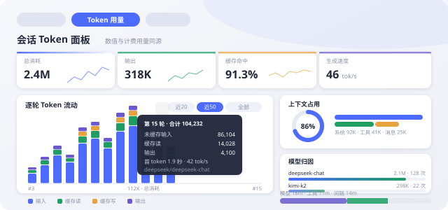

# dsh-token-pulse-view

中文说明：[README.zh.md](README.zh.md)

**Token Pulse — a token-usage dashboard for DeepSeek Harness (DSH).**

A Conversation View plugin that turns a session's model accounting into a real
dashboard. Same source as billing, zero browser-side log replay.



## What you get

Pick **Token usage** in the view tab row above any conversation:

- **Four glass KPI cards** — total consumed, output, cache-hit rate, decode TPS
  — each with a per-turn sparkline.
- **Per-turn token flow** — one stacked bar per turn (uncached input · cache
  read · cache write · output). Hover (or use ← → with the keyboard) for that
  turn's exact buckets, average first-token latency, TPS, and the models that
  answered it. Switch between **last 20 / last 50 / all turns**; long sessions
  fall back to a dense rendering.
- **Context donut gauge** — projected next-request occupancy ÷ route context
  window, turning warning-colored past 80% with a compaction heads-up, plus an
  approximate system / tools / messages composition bar.
- **Model attribution** — every `provider/model` ranked by billed weight with
  token totals, call counts, and share bars.
- **Where the time went** — the session wall clock split into model time, tool
  time, and gaps, alongside per-turn average, average TTFT, and session span.

## How the data is sourced

The dashboard never re-folds the session log in the browser. It reads the
host's durable session projections through `useProjection`:

| Projection | Provided by | Used for |
|---|---|---|
| `tokenUsage` | dsh-token-meter | billing buckets, cache hit, totals |
| `contextPressure` | dsh-token-meter | occupancy ÷ window |
| `contextBreakdown` | dsh-token-meter | system / tools / messages makeup |
| `sessionStats` | dsh-session-stats | turns, steps, model/tool/TTFT/decode time |
| `tokenPulse` | **this bundle** | the turn series + per-model attribution |

`tokenPulse` is a pure fold registered on `ctx.sessionProjections`, following
the token-meter billing rule exactly (one last-wins usage sample per turn/step
slot; `llm/retry-started` closes the slot so the retried attempt bills on top)
and the session-stats timing rule (model time = `step/start →
assistant/message`, first token survives an in-step retry, tool time pairs
`tool/call → tool/result`). Because it is a projection, the numbers are stable
across paging, compaction, and reopening the session.

Styling uses DSH theme tokens (`--dsw-alias-*`, `--dsw-font-*`), so the panel
follows light and dark mode and the host typography automatically.

## Privacy

Presentational only: no session writes, no network calls, no injection into
model context. Nothing leaves your machine.

## Install

This is a `#dsh-plugin`. Two ways:

1. **Plugin Hub (app store inside the Harness Web UI)** — open **Plugins / 插件市场**,
   search `token-pulse`, install.
2. **From a local directory** — **Plugins → Add plugin**, then point at this
   repository's checkout (or the packaged tarball).

Enable/disable lives in the **Plugins** list; turning the plugin off removes the
view and the projection unit.

## Self-hosted marketplace index (instant, no search lag)

GitHub's topic search is what Plugin Hub mirrors automatically, but the index
can take minutes-to-hours to catch a fresh repo. This repository also ships a
[DPMIDX](docs/market-index-format.md) file for Hub's custom-index sources —
zero sync lag:

```
https://raw.githubusercontent.com/swan-geese/dsh-token-pulse-view/main/dist/token-pulse.dpmidx
```

Add it under **Plugins → Plugin Hub → 设置 → 目录源 / list sources**. Regenerate
after any version bump:

```bash
node ~/.dsh/profiles/desktop/node_modules/dsh-plugin-hub/scripts/build-market-index.mjs \
  dist/market-entry.json dist/token-pulse.dpmidx
```

(`market-entry.json`'s `url` points at the v1.0.0 release asset; bump the tag
in that URL when you release a new version.)

## Layout

```
package.json          bundle manifest (dsh.bundle.patch + dsh.client)
cordis.patch.yml      inserts the `token-pulse-view` plugin row
index.js              host half: the `tokenPulse` session projection
client.js             browser half: the dashboard view (React, no JSX build step)
locale/{zh,en}.json   store metadata (title / description / detail)
docs/DETAIL{,.zh}.md  detail page copy
docs/preview.svg      feature image
icon.svg              plugin icon
```

No build step, no runtime dependencies: the browser half registers into the
module loader as `dsh-token-pulse-view`, the host half imports nothing.

## Uninstall / rollback

Disable the bundle, or remove it from the profile's plugin list. Removing it
drops the view tab and unregisters the projection; the session log is untouched.

## License

MIT
