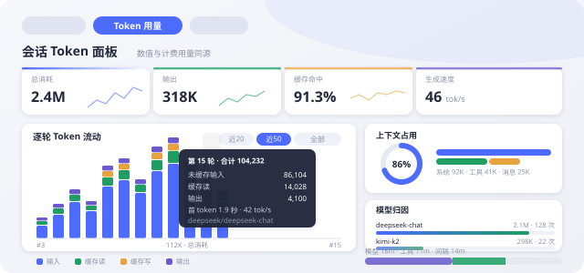

# dsh-token-pulse-view · Token 用量仪表盘

**把 DeepSeek Harness (DSH) 的 token 用量显示，升级成一块真正的会话数据仪表盘。**

English README: [README.md](README.md)



## 为什么需要它

DSH 自带的用量显示只是输入框上方两个小胶囊（速度 / 缓存命中率），点开也只有一个轮次的简单明细。本插件在对话上方的视图标签行里新增 **「Token 用量」** 页签，把整条会话的模型账单摊开成一块仪表盘——数字与计费同源，界面跟足主题。

## 你能看到什么

- **四张 KPI 玻璃卡**：总消耗、输出、缓存命中率、解码 TPS，每张右下角带一条逐轮迷你趋势线。
- **逐轮 Token 流动图**：每根柱子是一轮，从底到顶堆叠「未缓存输入 · 缓存读 · 缓存写 · 输出」四段。
  鼠标悬停（或键盘 ← → 方向键）任意柱，浮层显示该轮**精确分桶计数**、平均首 token 延迟、TPS 和参与作答的模型。
  右上角可切换 **近 20 / 近 50 / 全部轮次** 观察窗口；超长会话自动进入密集渲染不溢出。
- **上下文占用环形仪表**：下一次请求的预估占用 ÷ 路由上下文窗口；超过 80% 转为告警色并提示逼近压缩阈值。旁边是系统提示 / 工具定义 / 消息的近似构成条。
- **模型归因**：每个 `provider/model` 按计费权重排序，显示 token 用量、调用次数与占比条——多模型混用一眼看清谁在花钱。
- **时间去哪了**：把会话墙钟拆成模型生成、工具执行、间隔等待三段，附轮均消耗、平均首 token、会话总时长等指标。
- **跨会话范围（v1.1.0）**：顶部新增 **本会话 / 近 7 天 / 近 30 天 / 近 90 天** 切换。日窗口读取宿主只读统计接口
  （`GET /token-pulse/stats`），它按与投影完全相同的计费规则扫描本机持久会话档案，产出 DeepSeek 控制台「用量信息」
  同款视图：KPI 卡（计费请求数、Tokens 合计、缓存命中占比、有计费用量的会话数）、按本地日历日堆叠柱、
  按模型明细表（请求数 · 输入 · 缓存读 · 占比条）与消耗 Top 会话。扫描结果缓存 30 秒并设墙钟预算，
  超大档案只会标记「部分统计」，不会卡住接口。

## 数据从哪来（为什么可信）

面板**不在浏览器里重放会话日志**，所有数值直接读取宿主的持久化 session projection：

| 投影 | 来源 | 用途 |
|---|---|---|
| `tokenUsage` | dsh-token-meter | 计费分桶、缓存命中、总量 |
| `contextPressure` | dsh-token-meter | 上下文占用 ÷ 窗口上限 |
| `contextBreakdown` | dsh-token-meter | 系统 / 工具 / 消息近似构成 |
| `sessionStats` | dsh-session-stats | 轮次、步数、模型/工具/首 token 时间 |
| `tokenPulse` | **本插件** | 逐轮序列 + 按模型归因（宿主未发布的增量数据） |

`tokenPulse` 是本插件 Host 半边注册的一个纯折叠投影单元，计费规则与 token-meter 逐条一致（每轮每步一份 last-wins 用量样本；`llm/retry-started` 关闭槽位让重试**叠加**计费），时间口径与 session-stats 一致。因为是持久投影，**翻页、压缩、重开会话，读数都不会变**。

界面样式全部使用 DSH 主题 token（`--dsw-alias-*` / `--dsw-font-*`），自动跟随浅色 / 深色模式与宿主字号体系。

## 隐私

纯展示组件：**不写会话数据、不发任何网络请求、不向模型注入任何上下文**。所有数据只在你本机渲染。

## 安装

这是一个 `dsh-plugin`，三种途径任选：

1. **Plugin Hub 应用商店（推荐）**：DSH Web UI → 插件 → Plugin Hub「发现」页搜索 `token-pulse`，一键安装。
   本仓库带有 `dsh-plugin` topic，Hub 定时镜像 GitHub 后自动收录（新仓库索引有几分钟到几小时延迟）。
2. **自建目录源（零延迟）**：在 Plugin Hub 设置 → 目录源里添加：
   ```
   https://raw.githubusercontent.com/swan-geese/dsh-token-pulse-view/main/dist/token-pulse.dpmidx
   ```
3. **本地目录**：插件 → Add plugin → 选择本仓库的 checkout 目录。

安装后**重启 dsh** 生效；启停在「插件」列表里随时切换，关闭即移除视图与投影单元，会话日志零改动。

## 发版与验证记录

- `v1.0.0`（当前）：首个公开版本，Release 附件含成品包 `dsh-token-pulse-view-1.0.0.tgz`。
- 发布前自检：Plugin Hub `security-scan` 结果 **clean**；投影折叠逻辑通过合成事件流回归（重试叠加、last-wins 替换、跨路由归因回拨等 8 项断言全过）；中英文案键一一对应。

## 目录结构

```
package.json          市场元数据 + bundle 清单（dsh.bundle.patch / dsh.client）
cordis.patch.yml      插入 token-pulse-view 插件行
index.js              Host 半边：tokenPulse 会话投影（纯折叠，零外部依赖）
client.js             浏览器半边：仪表盘视图（React，无需构建）
locale/{zh,en}.json   商店标题 / 描述 / 详情页文案
docs/DETAIL{,.zh}.md  插件详情页正文
docs/preview.svg      特性预览图
dist/                 市场索引工件（token-pulse.dpmidx / market-entry.json / 发版说明）
icon.svg              插件图标
```

无构建步骤、无运行时依赖：宿主半边的 import 清单为空，浏览器半边经模块加载器注册。

## 卸载与回滚

在插件列表停用，或从 profile 移除该 bundle 即可。删除投影单元与视图，会话数据零改动。

## 许可

MIT
