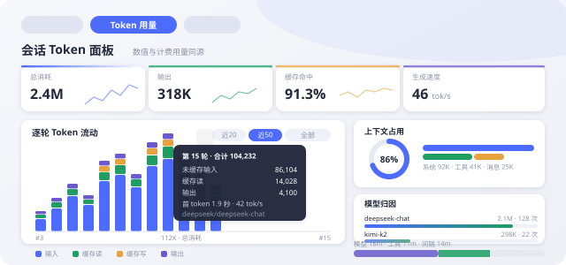

# Token Pulse — a session token dashboard

A new **Token usage** tab joins the view row above the conversation. It turns this session's model accounting into a dashboard whose every figure shares its source with billing.

## What you see

- **Four glass KPI cards**: total consumed, output, cache-hit rate, and decode TPS, each with a per-turn sparkline and a brand-gradient top edge.
- **Per-turn token flow**: one stacked bar per turn — uncached input, cache read, cache write, output from the base up. Hover a bar for that turn's exact buckets, average first-token latency, TPS, and the models that answered it. A **last 20 / last 50 / all turns** window switch sits at the panel corner.
- **Context donut gauge**: the projected next-request occupancy ÷ the route window; beyond 80% it turns warning-colored and flags the compaction threshold. Beside it, an approximate system / tools / messages composition bar.
- **Model attribution**: every `provider/model` ranked by billed weight with token totals, call counts, and share bars.
- **Where the time went**: the session wall clock split into model time, tool time, and gaps, plus per-turn average, average TTFT, and session-span metrics.

## Where the data comes from

The panel never re-folds the log in the browser. The host's durable projections — `tokenUsage`, `sessionStats`, `contextPressure`, `contextBreakdown` — are read through `useProjection`. This bundle's host half registers one extra projection unit, `tokenPulse`, carrying the two things the host does not publish as client values: the **turn series** and **per-model attribution**, billed with the same last-wins-per-slot, retry-additive rule as the token meter. Projections persist with the session log, so paging, compaction, and reopening never move the numbers.

## Boundaries

- Presentational only: no session writes, no network calls, no model context injection.
- A blank session shows a guided empty state; requests without provider-reported usage are not counted.
- Disabling or removing the plugin drops the view and the projection unit; nothing else is touched.
