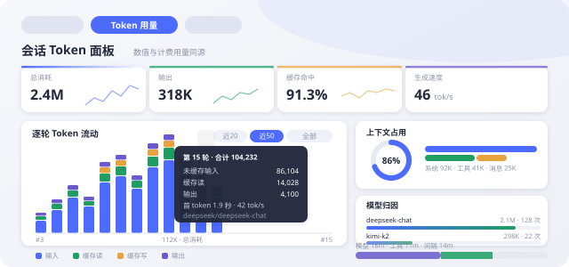

# Token Pulse — 会话 Token 用量仪表盘

在对话上方的视图标签行里多出一个 **Token 用量** 页签。它把这条会话的模型用量做成一块仪表盘，所有数字与计费用量同源。

## 你会看到什么

- **四张 KPI 玻璃卡**：总消耗、输出、缓存命中率、解码 TPS。每张卡右下角带一条逐轮迷你趋势线，顶部一道品牌色渐变描边。
- **逐轮 Token 流动图**：每根柱子是一轮，从下到上堆叠未缓存输入、缓存读、缓存写、输出四段；悬停任意柱显示该轮的精确分桶计数、平均首 token 延迟、TPS 与参与模型。右上角可切换 **近 20 / 近 50 / 全部轮次** 观察窗口。
- **上下文环形仪表**：下次请求的预估占用 ÷ 路由窗口上限，越过 80% 转为告警色并提示逼近压缩阈值；旁边给出系统提示 / 工具定义 / 消息的近似构成条。
- **模型归因**：每个 `provider/model` 按计费权重排序，显示用量、调用次数与占比条。
- **时间去哪了**：把会话墙钟拆成模型生成、工具执行、间隔等待三段，附轮均消耗、平均首 token、会话时长等指标。

## 数据从哪来

面板不自己数事件。宿主已有的持久投影 `tokenUsage`、`sessionStats`、`contextPressure`、`contextBreakdown` 直接经 `useProjection` 读入；本插件的 Host 半边额外注册一个 `tokenPulse` 投影单元，补充宿主未发布成客户端值的两样东西——**逐轮序列**和**按模型归因**，计费规则与 token-meter 一致（每轮每步 last-wins，重试叠加计费）。投影随会话日志持久化，翻页、压缩、重开会话都不改变读数。

## 边界

- 纯展示：不写会话数据、不发网络请求、不向模型注入任何内容。
- 空会话显示引导空态；provider 未回传 usage 的请求不计入。
- 关闭或卸载插件即移除该视图与投影单元，宿主行为不受影响。
